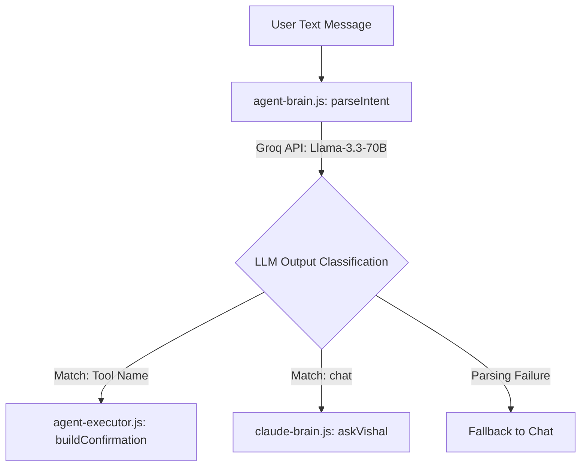

# AI Engine & Intent Parsing

Vishal uses a multi-model hybrid AI framework designed for high-speed, reliable intent classification and natural conversation.

---

## 1. Intent Parsing Flow

When the user submits a message, it is processed as follows:



### Groq Intent Parser (`agents/agent-brain.js`)
- Uses `openai/gpt-oss-120b` due to its high speed and complex reasoning.
- Uses a system prompt containing tool descriptions and strictly formatted JSON examples.
- **Strict Output Format**:
  ```json
  {
    "action": "tool_name_or_chat",
    "params": { ... },
    "confidence": 0.0-1.0,
    "reasoning": "Explanation of intent mapping"
  }
  ```
- **Time Context Injection**: We append the current date and local time dynamically during compilation. This allows relative dates (e.g. "schedule a sync tomorrow at 3 PM") to be parsed into precise ISO 8601 strings.

---

## 2. Chat Processing & Fallback (`agents/claude-brain.js`)

If the action is classified as `chat`, the conversation is processed in a resilient fallback setup:
1. **Primary Model**: Groq `openai/gpt-oss-120b` processes the chat using Vishal's custom personality instructions (`personality.py`).
2. **Fallback Model**: If Groq API rate limits are hit or the endpoint fails, the app automatically fails over to the Gemini API (`gemini-2.5-flash`).
3. **Memory Persistence**: Up to 10 historical conversation turns (`user`/`assistant`) are stored in memory to maintain context.

---

## 3. Voice Transcription (Whisper)

- The renderer records microphone audio via `MediaRecorder` in `audio/webm` format.
- The binary buffer is sent to the main process via the `transcribe-audio` IPC channel.
- In `agents/whisper.js`, the buffer is sent to the Groq Audio API using the `whisper-large-v3` model.
- The transcribed text is returned to the renderer, where it is populated in the chat input.
