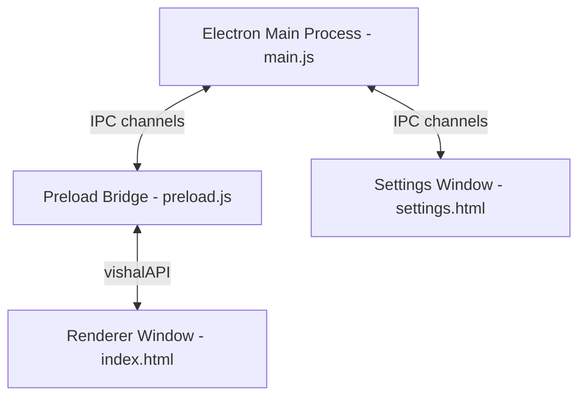

# Project Architecture Overview

Pixel PM is built as a hybrid desktop application utilizing **Electron**, combining system-level Node.js backend processes with web-based HTML/CSS/JS presentation overlays.

---

## 1. Process Model

### Main Process (`main.js`)
- Runs in a full Node.js environment.
- Manages window creation, global hotkeys, application lifecycle events, and tray/context menus.
- Orchestrates background monitoring tasks (e.g. GitHub watcher).
- Hosts the AI integration layers (Groq API, Gemini API, Whisper transcription).
- Directly executes OS-level operations (Volume, Sleep, Shutdown).

### Renderer Process (`renderer/index.html` + `character.js`)
- Renders the overlay visual assets, transparent canvas, and thought bubble interface.
- Executes the visual character loop (bobbing, walking, mood changes).
- Captures microphone input and sends audio chunks to the main process via IPC.
- Interacts with the user via mouse events (drag-and-drop repositioning).

### IPC Bridge (`preload.js`)
- Uses `contextBridge.exposeInMainWorld` to securely expose specific, safe APIs to the renderer window under `window.vishalAPI`.
- Prevents cross-site scripting (XSS) risks by turning off Node integration in the renderer.

---

## 2. Window Transparency & Click-Through

To achieve a transparent overlay where the user can click through empty space:
1. The `BrowserWindow` is initialized with `transparent: true`, `frame: false`, and `alwaysOnTop: true`.
2. Mouse click-through is controlled via `mainWindow.setIgnoreMouseEvents(ignore, { forward: true })`.
   - When the cursor enters the character container or the thought bubble is visible, the main process sets `ignoreMouseEvents(false)` (active mode).
   - When the cursor is outside the character and the bubble is hidden, it sets `ignoreMouseEvents(true)` (idle/click-through mode).
3. The CSS has strict pointer-event definitions:
   - `body { pointer-events: none; }`
   - `#vishal-container, #thought-bubble.visible { pointer-events: all; }`
